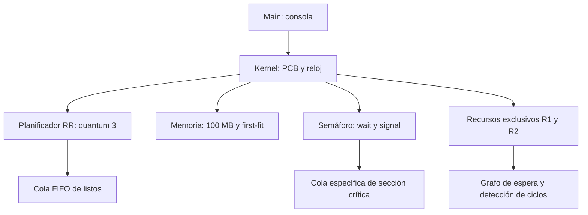

# Arquitectura

Estados: LISTO → EJECUTANDO → LISTO o TERMINADO. wait/solicitar pueden pasar de LISTO a BLOQUEADO_SEMAFORO o BLOQUEADO_RECURSO. signal/liberar despiertan al primer solicitante y lo devuelven a LISTO. Abortar pasa cualquier proceso activo a ABORTADO y libera sus reservas.

Solo la CPU avanza el reloj. Los comandos representan eventos atómicos entre turnos. El costo temporal de cambio de contexto es cero y cada expiración queda registrada. La memoria es contigua dinámica sin compactación, por lo que puede existir fragmentación externa. El detector cubre los dos recursos exclusivos, no ciclos mixtos con el semáforo.
